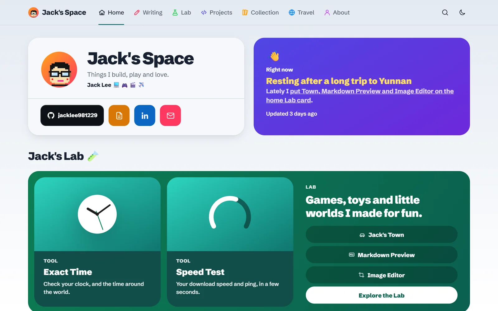
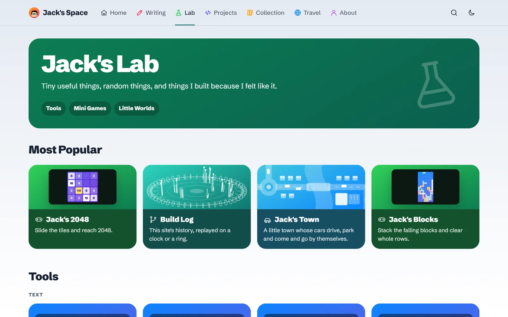
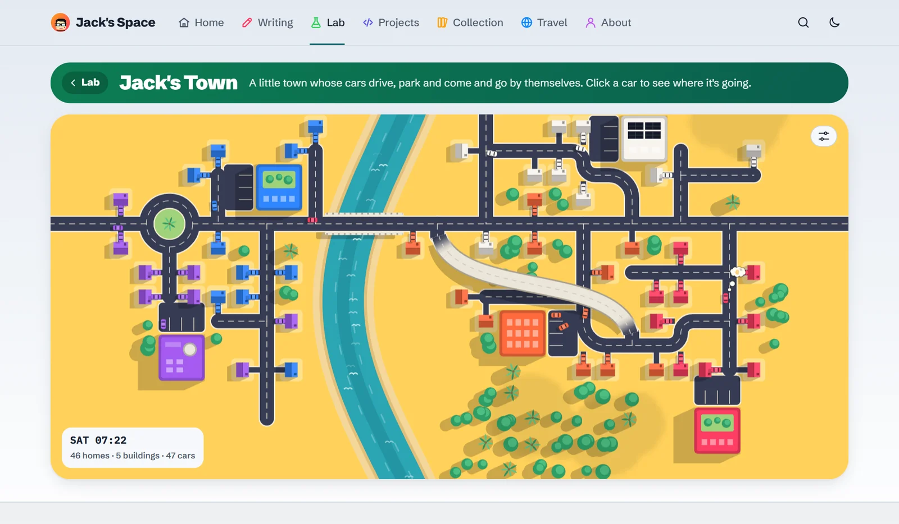

# Jack's Space

My personal site: things I build, play and love. It's live at **https://jacklee981229.github.io**.

- **Writing**: my posts, by topic and tag, with search.
- **Lab**: small tools that run in your browser (text, previews, images, PDFs, a QR code maker), mini games, effects to play with, and little worlds that run by themselves.
- **Projects**: the things I've built, with a short video of them.
- **Collection**: shows and games I love. **Travel**: a map of the places I've been.
- **Guestbook**, **Now** (what I'm up to) and the **Changelog** of the site itself.

| The Lab | Jack's Town, a little world |
|---|---|
|  |  |

## How it's built

- A static site made with [Astro](https://astro.build), served by GitHub Pages. Every push to `main` runs [the deploy](.github/workflows/deploy.yml): tests, type check, build, publish.
- The guestbook and the Now editor are small Cloudflare Workers, in `workers/`.
- Search is [Pagefind](https://pagefind.app), built with the site. Visits are counted by GoatCounter, without cookies. The fonts are served from the site itself.

## Run it

It needs Node 20.18. Package versions are pinned to ones that run on it, so don't upgrade them.

| Command | Does |
|---|---|
| `npm install` | Install the packages |
| `npm run dev` | The site with live reload at http://localhost:4321 |
| `npm run build` | Build into `dist/`, with the search index |
| `npm run preview` | Serve `dist/` at http://localhost:4321 |
| `npm run check` | Type check |
| `npm test` | Unit tests |
| `npm run new "Title" topic` | Start a draft post |

## Licence

Posts are licensed [CC BY-NC-SA 4.0](https://creativecommons.org/licenses/by-nc-sa/4.0/).
